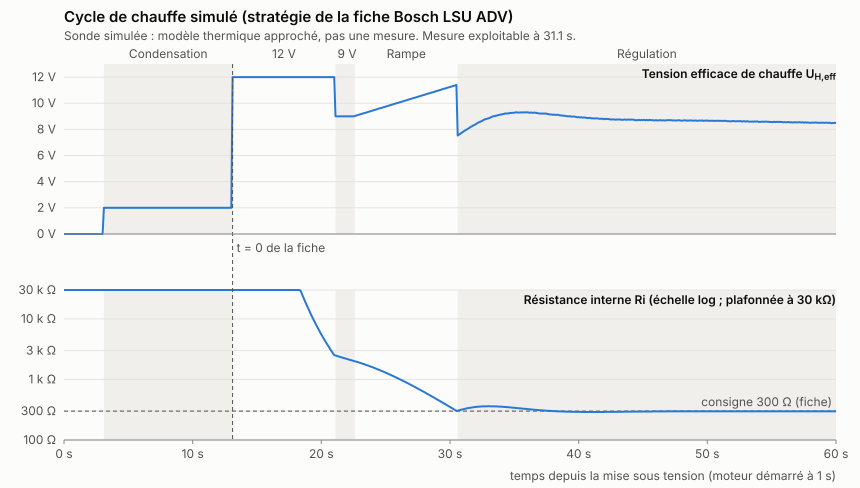

# Lecteur de sonde lambda Bosch LSU ADV, sans circuit Bosch

Le circuit d'évaluation que Bosch prévoit pour la LSU ADV (celui du LT4 ADV) est introuvable. Ici, c'est la carte qui fait son travail : elle **pilote la sonde directement**, à travers quelques amplificateurs opérationnels. Le programme :

1. **pilote la sonde** : il mesure la résistance interne Ri en injectant un courant alternatif, règle le courant de pompe pour tenir la cellule de Nernst à 450 mV, et chauffe selon la stratégie de la fiche Bosch ;
2. **affiche la richesse** : lambda à 3 décimales, AFR, barre riche/pauvre, état. Écrans possibles : TFT ST7735 (celui de `jan31a`), OLED SSD1306 ou LCD 16 × 2 ;
3. **envoie la richesse au Speeduino** : 0-5 V, avec 0 V = AFR 10 et 5 V = AFR 20, la même relation que `jan31a`.

Le principe et les valeurs de référence viennent du contrôleur open source **rusEFI** ([mck1117/wideband](https://github.com/mck1117/wideband), licence MIT). Il pilote ainsi les LSU 4.2, 4.9 et ADV sans circuit Bosch. Ses fichiers sont cités valeur par valeur dans « Sources ».

L'électronique n'existe pas encore : un **[schéma provisoire](docs/schema/README.md)** montre ce qu'il faut réaliser, et le programme tourne sur une **sonde simulée**, avec exactement le même code de pilotage que pour la vraie sonde.

## Cartes

| Carte | Pilotage direct | Pourquoi |
|---|---|---|
| **Raspberry Pi Pico** | **conseillée** | second cœur réservé à la sonde (2,5 kHz) ; ADC 12 bits rapide |
| ESP32 | possible | minuterie `esp_timer` à 2 kHz ; ADC moins linéaire |
| Arduino Mega 2560 | **abandonnée** | ADC 10 bits limité à ~9 600 mesures/s, 16 MHz sans calcul flottant : trop juste pour la boucle à 2,5 kHz. La compilation pour la Mega s'arrête sur un message d'erreur. |

## État

| Partie | État |
|---|---|
| Pilotage direct (Ri, pompe, chauffe), conversion en lambda | Fait, testé sur PC sur la sonde simulée |
| Gains de la boucle de pompe | Ceux de rusEFI, éprouvés sur de vraies sondes. Le modèle simulé est calé pour qu'ils y soient stables : **la simulation ne prouve pas leur stabilité sur la vraie sonde** |
| Gains de la régulation de chauffe | Réglés sur la sonde simulée : **à vérifier sur la vraie sonde** |
| Circuit analogique | **À dessiner** (voir « Ce que l'électronique devra réaliser »). Le pilotage d'une vraie sonde reste bloqué à la compilation tant que ses valeurs ne sont pas vérifiées. |
| Écrans, sortie Speeduino | Écrits, pas encore essayés sur du matériel |
| Compilation pour le Pico et l'ESP32 | **Pas encore faite** : seule la syntaxe a été contrôlée, avec des en-têtes Arduino simplifiés. Première chose à faire au premier essai. |

## Comment la carte remplace le circuit Bosch

```
                  ┌──────────────────── carte ────────────────────┐
  sortie PWM pompe ─► filtre ─► convertisseur tension-courant ─► IP (broche 1)
  ADC « Ip »       ◄─ ampli x10 ◄─ shunt 61,9 Ω (en série avec IP)
  ADC « Nernst »   ◄─ ampli x2,7 de (UN - VM)
  sortie injection ─► 22 kΩ ─► UN (broche 6, ou 5 sur l'ADV pre Turbo)
  masse virtuelle 1,65 V ─► VM / IPN (broche 2), commune aux deux cellules
  sortie PWM chauffe ─► MOSFET ─► H- (broche 3) ; H+ (broche 4) au +12 V
```

À chaque échantillon (2,5 kHz sur le Pico, 2 kHz sur l'ESP32) :

1. **Ri** : la sortie d'injection change de sens. L'écart de tension de Nernst entre les deux sens donne Ri = 22 kΩ ÷ (3,3 V ÷ écart − 1), moins la résistance série éventuelle (0 Ω sur le schéma, 10 Ω chez rusEFI) ; la moyenne donne la tension de Nernst. C'est la méthode de rusEFI.
2. **Pompe**, à 500 Hz : un régulateur PI (kP 50 mA/V, kI 10 000 mA/V/s, valeurs rusEFI) règle le courant de pompe pour tenir la tension de Nernst à 450 mV.
3. **Lambda** : le courant de pompe mesuré sur le shunt, filtré sur 20 ms, donne lambda par la table de la fiche Bosch.
4. **Chauffe**, à 100 Hz : stratégie de la fiche puis régulation sur Ri = 300 Ω, détaillée plus bas.

**Courant dans la cellule de Nernst.** Avec 22 kΩ et un créneau de 3,3 V, la cellule voit ±74 µA alternatifs autour d'un courant moyen de −20 µA, soit des pointes de +54 et −94 µA.
- La fiche ADV limite la « charge en courant de la cellule de Nernst » à 80 µA sans préciser s'il s'agit de l'amplitude alternative ou du courant de crête. **Point à vérifier avant de brancher une vraie sonde** ; une résistance de 27 kΩ ramène la crête sous 80 µA (à reporter dans `config.h`).
- Le courant moyen de −20 µA **sort** de l'électrode de référence : il l'appauvrirait en oxygène si la référence de l'ADV est « pompée » comme celle de la LSU 4.9, qui demande un courant entrant. Point à trancher ; le schéma prévoit une résistance R_REF en option ([schéma, point 1](docs/schema/README.md#points-à-trancher-avant-de-monter)). Ce courant décale aussi la tension de Nernst mesurée d'environ 6 mV, ce qui fausse lambda de +0,03 % à +0,26 % en simulation, très en dessous de la tolérance de la sonde.

**Protections** :
- **pompe seulement à chaud** : la pompe ne s'active que pendant la chauffe, une fois Ri ≤ 2,3 kΩ ; elle se coupe au-dessus de 3 kΩ. rusEFI l'active à 200 °C sous la consigne, soit environ 2,3 à 2,6 kΩ pour l'ADV d'après sa table ;
- **pompe en butée** plus de 0,5 s, signe d'un câblage ou d'un sens inversé : pompe coupée, deux nouveaux essais, puis pompe bloquée jusqu'au redémarrage ;
- **zéro de la mesure de courant** : recalé tout seul tant que la pompe est coupée ; s'il s'écarte de plus de 0,15 V du nominal, la pompe reste coupée ;
- **au démarrage**, chauffe coupée et pompe à 0 mA avant toute autre chose ;
- **chien de garde** : il n'est nourri que si les deux boucles tournent. Si la boucle de la sonde se bloque, la carte redémarre ;
- **vraie sonde bloquée à la compilation** tant que `CIRCUIT_VERIFIE` n'est pas défini dans `config.h`.

## Résultats sur la sonde simulée



| Essai (`tests/`) | Résultat |
|---|---|
| Cycle complet depuis le froid | pompe active à 21,2 s, mesure exploitable à 31,4 s, aucun défaut |
| Ri mesurée par injection | à 0,2 % près de la vraie valeur |
| Lambda fixe de 0,70 à 3,0 | écart moyen de +0,0003 à +0,0046 (≤ 0,26 %) |
| Saut de lambda 0,90 → 1,10 | 90 % atteints en 60 ms |
| Gaz +150 °C puis −200 °C | Ri revenue à 1,4 % près de 300 Ω au bout de 15 s |
| Zéro de mesure faussé de 12 mV | retrouvé à 0,1 mV près |
| Convertisseur de pompe câblé à l'envers | 3 mises en défaut puis pompe bloquée, mesure jamais déclarée valide |
| Zéro de mesure faussé de 0,3 V | défaut, pompe jamais activée |

Le modèle de la sonde est approché (thermique d'un seul bloc, cavité du premier ordre, Ri d'après la table de rusEFI). Ces chiffres valident le **logiciel**, pas le comportement de la vraie sonde.

## Ce que l'électronique devra réaliser

Le **[schéma provisoire](docs/schema/README.md)** (trois feuilles, nomenclature, points à trancher) détaille ces blocs. Valeurs tirées de la carte rusEFI f0_module sauf mention, toutes reportées dans `config.h`, section 4. Une autre valeur se change là.

| Bloc | À réaliser | Valeur de référence |
|---|---|---|
| Masse virtuelle | Tension stable sur VM/IPN, capable de fournir le courant de pompe | 1,65 V (Vcc ÷ 2), ampli suiveur puis 10 Ω |
| Commande de pompe | PWM filtrée (Sallen-Key ~1 kHz ; la boucle tourne à 500 Hz) puis source de courant de Howland vers IP ; plage ±3 mA | Ip = (V − 1,65 V) ÷ 316 Ω, soit +0,316 V/mA (rusEFI : −0,321 V/mA) |
| Mesure de pompe | Shunt en série avec IP, ampli référencé à 1,65 V vers l'ADC | 61,9 Ω, gain 10 (0,619 V/mA, ±2,6 mA mesurables) |
| Mesure de Nernst | Suiveur sur UN (pour ne pas charger l'injection), puis ampli différentiel de (UN − VM), VM prise sur la broche | gain 2,7 |
| Injection | Sortie logique vers UN à travers une résistance | 22 kΩ, créneau 0/3,3 V |
| Chauffage | MOSFET côté masse, grille tirée à la masse, fusible ; 8,7 W en régime établi d'après la fiche | PWM 200 Hz (fiche : ≥ 100 Hz) |
| Batterie | Pont diviseur et protection | 10 kΩ / 2 kΩ |
| Sortie Speeduino | Filtre RC et ampli ×1,52 (3,3 → 5 V), ou MCP4725 en 5 V | voir plus bas |

**Points d'attention** :
- **Pompe à 0 mA au démarrage.** Le nœud de commande de la pompe doit rester à 1,65 V tant que le programme n'a pas démarré, par exemple avec un pont diviseur. Sinon un courant peut traverser la sonde à froid.
- **Une seule référence.** Les amplis et l'ADC doivent partager la même référence 3,3 V : les mesures sont alors ratiométriques.
- **Chauffage.** La résistance à froid n'est pas dans la fiche. Le courant de crête, Ubat ÷ cette résistance, est à mesurer pour dimensionner le MOSFET et le fusible.
- **Protection des entrées.** Toutes les entrées reliées au faisceau doivent être protégées contre les surtensions de la voiture.

**Brochage par défaut** (`config.h`, section 7) :

| Signal | Pico | ESP32 |
|---|---|---|
| ADC Nernst | GP26 | 34 |
| ADC Ip (shunt) | GP27 | 35 |
| ADC batterie | GP28 | 32 |
| Injection pour Ri | GP14 | 27 |
| PWM pompe | GP10 (30 kHz, 12 bits) | 33 (19 kHz, 12 bits) |
| PWM chauffe | GP15 (200 Hz) | 26 (200 Hz) |
| PWM sortie Speeduino | GP13 (30 kHz) | 25 (15 kHz) |
| TFT : CS, DC, RST / SCK, MOSI | GP17, GP20, GP21 / GP18, GP19 | 5, 2, 4 / 18, 23 |
| I2C : SDA, SCL | GP4, GP5 | 21, 22 |

**Brochage de la sonde** (fiche, pages 2 et 3) :

| Broche | LSU ADV, connecteur 1 928 404 669 | LSU ADV pre Turbo, connecteur 1254.488.136 |
|---|---|---|
| 1 | IP / APE | IP / APE |
| 2 | VM / IPN | VM / IPN |
| 3 | Uh- / H- | Uh- / H- |
| 4 | Uh+ / H+ | Uh+ / H+ |
| 5 | non connectée | UN / RE |
| 6 | UN / RE | — |

Contre-pièces : F02U.B00.725-01 (ADV) et F02U.B00.937-01 (pre Turbo). La version à connecteur motorsport a un autre brochage (fiche, pages 2 et 3).

## Premier essai, en simulation

**En simulation, aucune sonde ne doit être branchée** : les sorties de pompe, d'injection et de chauffe suivent la sonde simulée.

1. **Installer le core de la carte** :
   - Pico : « Raspberry Pi Pico/RP2040 » d'Earle Philhower, pas le core Arduino Mbed ;
   - ESP32 : « esp32 » d'Espressif.
2. **Installer les bibliothèques de l'écran** : « Adafruit GFX Library », puis « Adafruit ST7735 and ST7789 Library » ou « Adafruit SSD1306 ». Le LCD 16 × 2 et le MCP4725 n'en demandent pas.
3. **Ouvrir** `LecteurLambda/LecteurLambda.ino`, choisir l'écran dans `config.h`, téléverser. Avec PlatformIO :

```bash
cd lecteur-lambda
```

```bash
pio run -e pico -t upload
```

**Ce qu'on doit voir** :
- l'écran passe par les phases de chauffe, puis « ACCROCHAGE POMPE » ;
- la mesure devient exploitable vers 31 s ;
- lambda oscille ensuite entre environ 0,85 et 1,15.

**Le journal série** (115200 bauds) donne une ligne CSV toutes les 100 ms : phase, tension de Nernst, Ri, courant de pompe commandé et mesuré, lambda, AFR, batterie, chauffe, état de la pompe, sortie, défauts.

| Commande série | Effet |
|---|---|
| `sortie 2.35` | Impose 2,35 V au Speeduino, pour calibrer la sortie au multimètre |
| `sortie auto` | Revient à la mesure |
| `lambda 0.90` | Impose lambda en simulation |
| `lambda auto` | Revient au profil automatique |

## Mise en service sur la vraie sonde

À faire dans cet ordre, en suivant le journal série.

1. **Sans sonde.** Vérifier :
   - la masse virtuelle à 1,65 V ;
   - le nœud de commande de pompe à 1,65 V au démarrage ;
   - la colonne `Ip_mA` autour de 0.
2. **Avec des résistances à la place de la sonde** : environ 100 Ω entre IP et VM, et 300 Ω entre UN et VM.
   - Alimenter sous 12 V : sous 13,2 V, la chauffe et la pompe restent à l'arrêt. Une résistance ne donne aucune tension de Nernst, et la pompe partirait en butée.
   - La colonne `Ri_ohm` doit lire environ 300 : cela valide la mesure par injection.
3. **Reporter les valeurs mesurées** du circuit dans `config.h`, section 4, puis définir `CIRCUIT_VERIFIE` et passer `CFG_MESURE` à `MESURE_SONDE`.
4. **Sonde à l'air libre, moteur arrêté**, alimentation de laboratoire à 13,5-14 V :
   - Ri descend vers 300 Ω ;
   - la pompe s'active puis s'accroche, avec `Nernst_V` stable près de 0,45 ;
   - l'écran affiche `AIR`, car à l'air libre lambda est au-delà de 5.
   Si la tension de Nernst oscille fort ou si la pompe passe en défaut de butée, revoir le sens du convertisseur de pompe, puis les gains de pompe dans `lsu_driver.h`.
5. **Sur la voiture** : vérifier la régulation de chauffe sur la durée, au ralenti et en charge, avec le journal. La sortie Speeduino se calibre au multimètre avec `sortie 1.00` puis `sortie 4.00`.

## Chauffe : la stratégie de la fiche

| Phase | Tension efficace | Durée | Source |
|---|---|---|---|
| Attente moteur | 0 V | jusqu'à Ubat ≥ 13,2 V pendant 2 s (alternateur qui charge) | choix du programme |
| Condensation | 2,0 V (fiche : 1,8 à 2 V) | 10 s, réglable : « propre à l'application » | fiche + réglage |
| Chauffe rapide | 12 V | 8 s au maximum | fiche |
| Palier | 9 V | 1,5 s | fiche |
| Rampe | +0,3 V/s au plus, plafond 12 V | jusqu'à Ri ≤ 300 Ω | fiche ; plafond et limite de 20 s ajoutés |
| Régulation | régulateur PI sur ln(Ri ÷ 300 Ω), départ à 7,5 V | permanente | 300 Ω et 7,5 V : fiche ; régulateur : programme |

- **Tension efficace** : avec une PWM sous Ubat, U_eff = Ubat × √(rapport cyclique). Le programme calcule le rapport cyclique = (U_eff ÷ Ubat)².
- **Régulation anticipée** : elle commence dès que Ri atteint 300 Ω, même pendant la chauffe rapide.
- **Sécurités** :
  - chauffe coupée hors 10,8-16,5 V, la plage d'alimentation de la fiche ;
  - défaut si Ri n'atteint pas 300 Ω 20 s après le début de la rampe ;
  - défaut si Ri sort de 100 à 3 000 Ω plus de 3 s en régulation ;
  - après un défaut, deux nouveaux essais, puis chauffe bloquée jusqu'au redémarrage.
- **Comparaison avec rusEFI** : 2 V pendant 5 s, rampe depuis 7 V à 0,4 V/s jusqu'à 12 V, régulation en partant de 7,5 V. Le programme suit la fiche de l'ADV plutôt que ces valeurs.

## Mesure de la richesse

- **Ip → lambda** par la table de la fiche (23 points), interpolée en 1/lambda. En retirant un point puis en le recalculant, l'écart maximal est de 1,24 %, contre 1,61 % en interpolation linéaire. rusEFI utilise des courbes ajustées sur la même plage.
- **Hors table** : sous lambda 0,65, l'écran affiche `<0.65` ; au-dessus de 5 (air libre, coupure d'injection), `AIR`.
- **Pression des gaz** : la correction de la fiche n'est pas appliquée. Le moteur est atmosphérique et la sonde travaille à une pression proche de l'atmosphère.
- **Précision** : elle dépend de la mesure du courant de pompe. Avec 0,619 V/mA, 0,001 de lambda vaut environ 0,65 mV autour de lambda 1. Le zéro est recalé automatiquement ; le gain dépend de la précision du shunt et de l'ampli (résistances à 0,1 % conseillées).

## Sortie vers le Speeduino

- **Relation** : AFR = 10 + 2 × V, soit 0 V = AFR 10, 2,35 V = lambda 1 et 5 V = AFR 20, en essence à 14,7 (`config.h`, section 3).
- **TunerStudio** :
  - *Tools → Calibrate AFR Table*, choisir *Custom Linear WB*, 0 V = 10, 5 V = 20 ;
  - puis passer *EGO sensor type* (`egoType`) sur *Wide band*. Il est sur *Disabled* dans la carto de test et sur *Narrow Band* dans le tune actuel.
- **Entrée du Speeduino** : A8 sur la carte v0.4 (`init.cpp` 202402, ligne 1484), avec 470 Ω en série, des condensateurs et des diodes d'écrêtage, sans pont diviseur (schéma v0.4).
- **Pendant la chauffe et en défaut**, la sortie est à **5 V (AFR 20)**. Le firmware 202402 ne corrige que si `ego_min < O2 < ego_max` ([corrections.cpp, ligne 618](https://github.com/speeduino/speeduino/blob/202402/speeduino/corrections.cpp#L618)) ; avec `ego_max_afr = 17`, aucune correction n'est donc appliquée tant que la mesure n'est pas prête. **Garder `ego_max_afr` sous 20.**
- **Étage de sortie** : PWM filtrée puis ampli ×1,52, ou MCP4725 alimenté en 5 V, avec un adaptateur de niveaux I2C à prévoir (3,3 V côté carte, à confirmer sur la fiche du MCP4725). Calibration avec `sortie 1.00` et `sortie 4.00`, écarts reportés dans `SORTIE_CORR_GAIN` et `SORTIE_CORR_DECALAGE_V`.

## Fichiers

| Fichier | Rôle |
|---|---|
| `LecteurLambda/LecteurLambda.ino` | Croquis à ouvrir dans l'IDE Arduino |
| `LecteurLambda/config.h` | **Tous les réglages** : mode, écran, sortie, circuit, brochage |
| `LecteurLambda/lsu_driver.*` | Pilotage direct : Ri par injection, boucle de pompe, coordination avec la chauffe |
| `LecteurLambda/heater.*` | Stratégie de chauffe de la fiche et régulation sur Ri |
| `LecteurLambda/lsu_adv.*` | Table Ip → lambda de la fiche, conversions |
| `LecteurLambda/sim_hardware.*` | Sonde et circuit simulés, échantillon par échantillon |
| `LecteurLambda/hal.*` | PWM, ADC, second cœur ou minuterie, verrou, chien de garde |
| `LecteurLambda/app.*` | Boucle rapide et boucle principale, journal, commandes |
| `LecteurLambda/display.*`, `speeduino_out.*`, `format.h` | Écrans et sortie Speeduino |
| `tests/` | Tests sur PC et tracé du cycle simulé |
| `docs/cycle-chauffe-simule.*` | Cycle simulé : données (CSV) et graphe (SVG) |
| `docs/schema/` | Schéma électronique provisoire (3 feuilles SVG), nomenclature, générateur `genere_schema.py` |

## Tests sur PC

```bash
cd lecteur-lambda/tests
```

```bash
make
```

**Ce qu'ils vérifient** :
- la table Bosch et la relation UA ↔ Ip de la fiche ;
- la conversion en lambda ;
- la sortie 0-5 V et la mise en forme de l'écran ;
- la formule de Ri ;
- le cycle complet sur la sonde simulée ;
- la précision de lambda, la réponse à un saut, la tenue de la chauffe ;
- les protections de la pompe et de la chauffe.

Résultat actuel : 380 856 vérifications, 0 échec. `make trace` régénère le graphe.

## Sources

- **Fiche Bosch** Motorsport « Lambda Sensor LSU ADV/ADV pre Turbo », 51946891, 06/05/2021 : [fiches-techniques/lambda/adv_pre_turbo.pdf](../fiches-techniques/lambda/adv_pre_turbo.pdf). Table Ip/lambda, stratégie de chauffe, Ri nominale de 300 Ω, courant de 80 µA au plus dans la cellule de Nernst et chauffage ≥ 100 Hz en p. 1-2 ; brochage en p. 2-3.
- **rusEFI wideband**, [github.com/mck1117/wideband](https://github.com/mck1117/wideband), licence MIT :
  - `firmware/wideband_config.h` : consigne de Nernst 0,45 V, shunt 61,9 Ω, gain 10 ;
  - `firmware/pump_control.cpp` : PI de pompe kP 50, kI 10 000, 500 Hz ; pompe seulement à chaud ;
  - `firmware/pump_dac.cpp` : −0,000321162 V/µA autour de Vcc ÷ 2 ;
  - `firmware/sampling.cpp` : démodulation de Ri sur trois échantillons, table Ri → température de l'ADV ;
  - `firmware/heater_thread.cpp` : ADV à 785 °C et 300 Ω ;
  - `firmware/boards/f0_module/` : 22 kΩ d'injection, gain de Nernst 2,7, 10 Ω sur VM, ADC 3,3 V.
- **Firmware Speeduino 202402** :
  - [corrections.cpp, ligne 618](https://github.com/speeduino/speeduino/blob/202402/speeduino/corrections.cpp#L618) : fenêtre `ego_min`/`ego_max` ;
  - [sensors.cpp, `readO2`](https://github.com/speeduino/speeduino/blob/202402/speeduino/sensors.cpp#L596) ;
  - [init.cpp, ligne 1484](https://github.com/speeduino/speeduino/blob/202402/speeduino/init.cpp#L1484) : `pinO2 = A8`.
- **Schéma Speeduino v0.4** : [fiches-techniques/speeduino/](../fiches-techniques/speeduino/), entrée O2.
- **Tune actuel** : [cartographies/2026-11-02-tune-actuel.msq](../cartographies/2026-11-02-tune-actuel.msq).
