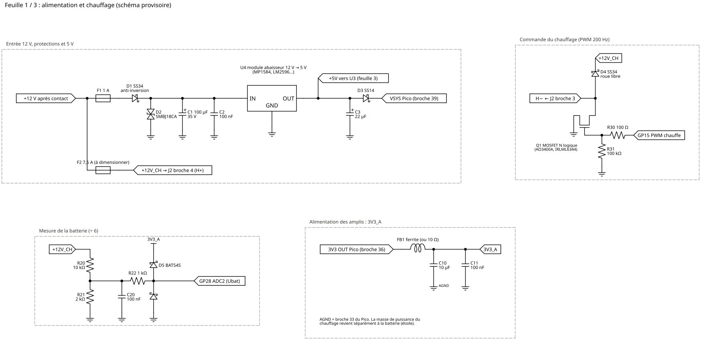
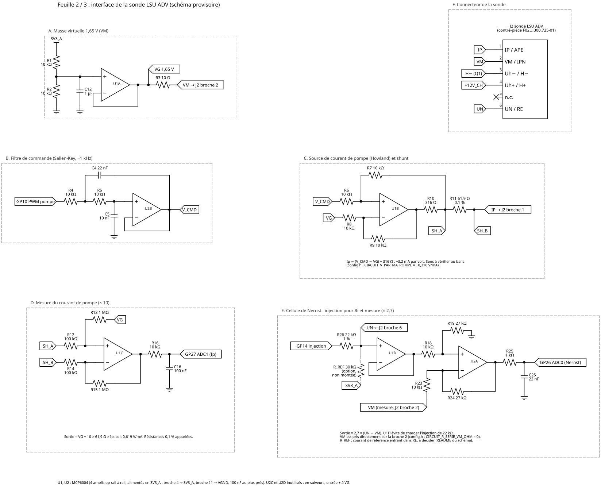
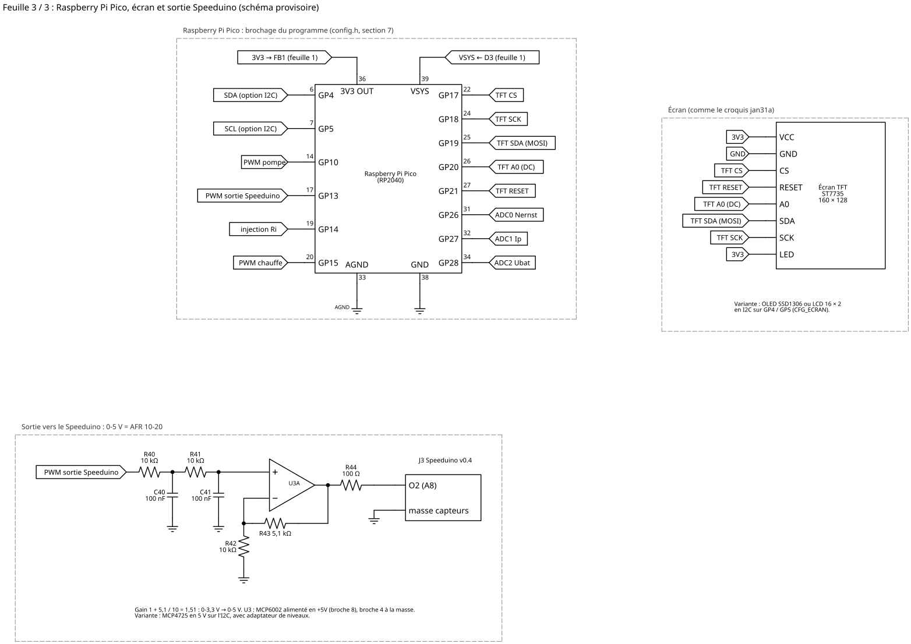

# Schéma électronique provisoire

Schéma de travail du lecteur lambda LSU ADV piloté directement par un Raspberry Pi Pico, **sans circuit Bosch**. Il sert à visualiser ce qu'il faut réaliser, **pas à fabriquer une carte** : il n'a été ni simulé en électronique, ni monté, ni mesuré.

Les feuilles sont reliées par des **étiquettes de réseau** : deux étiquettes au même nom (VG, VM, IP, UN, V_CMD, SH_A, +12V_CH…) sont le même fil. Les valeurs suivent `LecteurLambda/config.h` (section 4).

## Feuille 1 : alimentation et chauffage



- **Entrée 12 V** : fusible F1, diode anti-inversion D1, diode de protection D2, module abaisseur 12 → 5 V. Le Pico est alimenté par VSYS à travers D3, ce qui permet de garder l'USB branché.
- **Chauffage** : il passe par son propre fusible F2. Q1 commute le côté masse du chauffage (H−). R31 tient Q1 bloqué tant que le programme ne tourne pas, et D4 absorbe la surtension de coupure du câblage.
- **Mesure de la batterie** : prise sur le +12 V du chauffage, après F2 et avant D1, pour que le programme calcule la tension efficace de chauffe sur la bonne tension. Pont ÷ 6, filtre, puis diodes d'écrêtage vers l'ADC.
- **3V3_A** : tension des amplis tirée du 3V3 du Pico à travers une ferrite. L'ADC du Pico prend sa référence sur ce même 3,3 V, donc toutes les mesures sont ratiométriques.

## Feuille 2 : interface de la sonde



| Bloc | Rôle | Relation |
|---|---|---|
| A. Masse virtuelle | Tient VM (électrode commune de la sonde) à 1,65 V et absorbe le courant de pompe | VG = 3V3_A ÷ 2 |
| B. Filtre de commande | Lisse la PWM de pompe à 30 kHz (filtre de Sallen-Key d'environ 1 kHz, ondulation résiduelle de l'ordre de 4 mV) | V_CMD = moyenne de la PWM |
| C. Source de Howland | Transforme V_CMD en courant de pompe dans IP, quelle que soit la résistance de la cellule | Ip ≈ (V_CMD − VG) ÷ 316 Ω |
| D. Mesure de Ip | Ampli différentiel ×10 sur le shunt de 61,9 Ω ; résistances de 100 kΩ et 1 MΩ pour ne pas prélever de courant sur la boucle | V = VG + 0,619 V/mA × Ip |
| E. Nernst | Injection pour Ri à travers R26 ; U1D lit UN sans charger l'injection ; U2A amplifie (UN − VM) prise directement sur la broche VM | V = 2,7 × (UN − VM) |
| F. Connecteur | Brochage de la LSU ADV, connecteur automobile (fiche Bosch p. 2) | — |

## Feuille 3 : Pico, écran et sortie Speeduino



- **Brochage du Pico** : identique à `config.h`, section 7. AGND (broche 33) sert de masse aux mesures.
- **Écran TFT ST7735** : celui de `jan31a`, en SPI.
- **Sortie Speeduino** : la PWM passe par deux filtres RC, puis U3A (alimenté en 5 V, gain 1,51) la porte de 0-3,3 V à 0-5 V. Elle sort vers l'entrée O2 du Speeduino (A8), avec la masse capteurs du Speeduino en commun.

## Nomenclature

La colonne « Dans votre liste ? » est à remplir avec votre liste de composants : je n'ai pas pu la lire, car `docs.google.com` est bloqué depuis l'environnement où ce schéma a été préparé.

| Repère | Valeur | Rôle | Dans votre liste ? |
|---|---|---|---|
| — | Raspberry Pi Pico | carte | |
| U1, U2 | MCP6004 (4 amplis op rail à rail, 3,3 V) | interface sonde | |
| U3 | MCP6002 (2 amplis op rail à rail, 5 V) | sortie Speeduino | |
| U4 | module abaisseur 12 → 5 V (MP1584, LM2596…) | alimentation | |
| Q1 | MOSFET N à commande logique, RDS(on) garanti à VGS 2,5 V (AO3400A, IRLML6344) | chauffage | |
| D1, D4 | SS34 (Schottky 3 A) | anti-inversion, roue libre | |
| D2 | SMBJ18CA (TVS bidirectionnelle) | surtensions | |
| D3 | SS14 (Schottky 1 A) | VSYS | |
| D5 | BAT54S | écrêtage ADC batterie | |
| FB1 | ferrite (ou 10 Ω) | filtrage 3V3_A | |
| F1, F2 | fusibles 1 A et 7,5 A (F2 à dimensionner) + porte-fusibles | protections | |
| R11 | 61,9 Ω 0,1 % | shunt de pompe | |
| R12, R14 | 100 kΩ 0,1 % | ampli de Ip | |
| R13, R15 | 1 MΩ 0,1 % | ampli de Ip | |
| R18, R23 | 10 kΩ 0,1 % | ampli de Nernst | |
| R19, R24 | 27 kΩ 0,1 % | ampli de Nernst | |
| R10 | 316 Ω 1 % | source de Howland | |
| R26 | 22 kΩ 1 % | injection pour Ri | |
| R1, R2, R4–R9, R16, R20, R40–R42 | 10 kΩ 1 % (13 pièces) | divers | |
| R21 | 2 kΩ 1 % | pont batterie | |
| R22, R25 | 1 kΩ | protection et filtre ADC | |
| R3 | 10 Ω | sortie de la masse virtuelle | |
| R30, R44 | 100 Ω | grille de Q1, sortie Speeduino | |
| R31 | 100 kΩ | rappel de grille | |
| R43 | 5,1 kΩ 1 % | gain de la sortie | |
| R_REF | 30 kΩ (option, non montée) | courant de référence, voir plus bas | |
| C1 | 100 µF 35 V | entrée 12 V | |
| C3 | 22 µF | 5 V | |
| C10 | 10 µF | 3V3_A | |
| C12 | 1 µF | masse virtuelle | |
| C4 | 22 nF C0G | filtre de pompe | |
| C5 | 10 nF C0G | filtre de pompe | |
| C25 | 22 nF | filtre ADC Nernst | |
| C2, C11, C16, C20, C40, C41 + 3 de découplage (U1, U2, U3) | 100 nF | filtrage, découplage | |
| J1 | connecteur 12 V / masse | alimentation | |
| J2 | contre-pièce Bosch F02U.B00.725-01 | sonde LSU ADV | |
| J3 | connecteur vers le Speeduino | sortie O2 | |
| — | écran TFT ST7735 160 × 128 | affichage | |

**Équivalents** : n'importe quel ampli op rail à rail en entrée et en sortie, alimenté sous 3,3 V, convient pour U1 et U2 (par exemple OPA2340, TLV2372 ou MCP6022). Un LM358 ne convient pas : ni son entrée ni sa sortie ne montent jusqu'à 3,3 V. Si une valeur de précision manque, une valeur voisine convient, à condition de la reporter dans `config.h` (section 4).

## Points à trancher avant de monter

1. **Courant de référence de la cellule de Nernst (R_REF).** Avec l'injection telle que dessinée, un courant moyen de −20 µA **sort** de l'électrode de référence (RE). Or une référence « pompée » (celle de la LSU 4.9, par exemple) doit recevoir un courant **entrant**, qui y apporte de l'oxygène ; un courant sortant l'appauvrit. La fiche ADV fournie ne dit pas si sa référence est pompée. R_REF (30 kΩ vers 3V3_A) donnerait environ +20 µA entrants nets. À trancher avec une documentation Bosch de l'ADV ou le schéma de rusEFI ; si R_REF est montée, il faudra l'ajouter au calcul de Ri (`lsu_driver.cpp`, `esrFromAc`), car elle dérive une partie du courant d'injection.
2. **Pointe de courant dans la cellule de Nernst.** Avec 22 kΩ, elle atteint 94 µA, pour un maximum de 80 µA dans la fiche (amplitude ou crête : non précisé). 27 kΩ la ramène à 77 µA (valeur à reporter dans `config.h`).
3. **Sens de la pompe.** Le schéma donne Ip > 0 quand V_CMD > 1,65 V. Ip > 0 correspond au mélange pauvre (fiche Bosch). Pour évacuer l'oxygène de la cavité, le courant doit entrer par IP : c'est le sens choisi, à confirmer au banc. Si le sens est faux, le programme met la pompe en défaut de butée puis la bloque.
4. **Dimensionnement du chauffage.** La résistance du chauffage à froid n'est pas dans la fiche. Elle fixe le courant de crête (Ubat ÷ R), donc F2 et Q1 : à mesurer à l'ohmmètre sur la sonde.
5. **Plage de la source de Howland sous 3,3 V.** Elle suffit pour la plage de la sonde (±1,4 mA). Au-delà de ±2 mA, la sortie de U1B approche des rails : si besoin, baisser R10 (et `CIRCUIT_V_PAR_MA_POMPE`) ou alimenter U1 sous 5 V avec une masse virtuelle adaptée.
6. **Masses.** Le retour du chauffage (plusieurs ampères) ne doit pas passer par la masse des mesures : masse en étoile, AGND séparée.
7. **Écrans en I2C.** L'OLED SSD1306 fonctionne en 3,3 V. Le LCD 16 × 2 et le MCP4725, alimentés en 5 V, demandent un adaptateur de niveaux I2C.

## Régénérer les feuilles

```bash
pip install schemdraw
```

```bash
python3 genere_schema.py
```
